# Logistimus — Database Schema

Status: **Phase 0 deliverable** · Engine: **PostgreSQL 16 + PostGIS 3.4** · ORM: Django 5.2 · Migrations: per-app, forward-only in CI.

---

## 1. Conventions

| Rule | Detail |
|---|---|
| Primary keys | `id uuid PRIMARY KEY DEFAULT gen_random_uuid()` for all externally exposed entities (Django `uuid.uuid4` default). Internal join tables may use bigints. |
| Tenant key | every tenant-owned table: `organization_id uuid NOT NULL REFERENCES organizations(id) ON DELETE CASCADE` |
| Timestamps | `created_at timestamptz NOT NULL`, `updated_at timestamptz NOT NULL` (auto `now()`/trigger or Django `auto_now`) |
| Money | `numeric(14,2) NOT NULL` + `currency char(3) NOT NULL` (ISO 4217) — **never float/double** |
| Weights/measures | `numeric(12,3)` (`weight_kg`, `liters`) |
| Soft delete | only where history must survive deletion: `Organization`, `Order`, `Customer`, `Vehicle`, `Document` get `deleted_at timestamptz NULL` (+ partial unique index `WHERE deleted_at IS NULL`). Everything else hard-deletes. |
| Human refs | `ref varchar(32)` generated per org with **tenant-aware unique constraint** `UNIQUE (organization_id, ref)` |
| Enums | Django `TextChoices` + `CHECK (col IN (…))` at DB level for status columns |
| Timezone | all datetimes `timestamptz`; `DateField` only for pure calendar dates (due dates, billing periods) |
| Booleans for flags | `is_primary`, `is_verified`, … |

---

## 2. Entity Relationship Diagram (logical)

```mermaid
erDiagram
    Organization ||--o{ Branch : has
    Organization ||--o{ Department : has
    Organization ||--o{ OrganizationMembership : has
    User ||--o{ OrganizationMembership : joins
    OrganizationMembership }o--|| Role : has
    Role ||--o{ RolePermission : grants
    Permission ||--o{ RolePermission : "granted by"
    Organization ||--o{ Subscription : has
    Plan ||--o{ Subscription : "of plan"
    Organization ||--o{ Customer : serves
    Customer ||--o{ Contact : has
    Customer ||--o{ Contract : has
    Customer ||--o{ Order : places
    Organization ||--o{ Order : owns
    Order ||--o{ OrderItem : contains
    Order ||--o{ OrderStatusHistory : "history"
    Order ||--o{ Shipment : "transport legs"
    Shipment ||--o{ ShipmentStop : stops
    Shipment ||--o{ ShipmentStatusHistory : history
    Shipment ||--o{ ProofOfDelivery : "pods"
    Organization ||--o{ Route : has
    Route ||--o{ RouteStop : has
    Route ||--o{ RouteSuggestion : suggests
    Dispatch ||--o{ DispatchStop : stops
    Route ||--o{ Dispatch : "uses"
    Driver ||--o{ Dispatch : drives
    Vehicle ||--o{ Dispatch : carries
    Organization ||--o{ Dispatch : owns
    Organization ||--o{ Vehicle : owns
    VehicleCategory ||--o{ Vehicle : typed_by
    Vehicle ||--o{ VehicleDocument : has
    Vehicle ||--o{ MaintenanceRecord : has
    Vehicle ||--o{ FuelRecord : has
    Organization ||--o{ Driver : employs
    Driver ||--o{ DriverDocument : has
    Driver ||--o{ DutyLog : logs
    Driver ||--o{ VehicleInspection : inspects
    User ||--o| Driver : "portal link"
    Organization ||--o{ Warehouse : owns
    Warehouse ||--o{ DockBay : has
    Warehouse ||--o{ StorageZone : has
    Warehouse ||--o{ StockLevel : holds
    InventoryItem ||--o{ StockLevel : "at bin"
    InventoryItem ||--o{ StockMovement : ledger
    InventoryItem }o--|| Organization : belongs
    Organization ||--o{ Invoice : bills
    Customer ||--o{ Invoice : receives
    Invoice ||--o{ InvoiceLineItem : lines
    Invoice ||--o{ Payment : payments
    Organization ||--o{ Expense : spends
    Organization ||--o{ CarrierSettlement : settles
    Organization ||--o{ Document : stores
    Document ||--o{ DocumentAssociation : links
    Organization ||--o{ Notification : notifies
    User ||--o{ Notification : receives
    Vehicle ||--o{ VehicleLocation : pings
    Vehicle ||--o{ VehicleTelemetry : telemetry
    GPSDevice ||--o| Vehicle : attached_to
    AIConversation ||--o{ AIMessage : contains
    AIConversation }o--|| User : owns
    AIMessage ||--o{ AIRecommendation : suggests
    Organization ||--o{ APIKey : issues
    Organization ||--o{ Webhook : issues
    User ||--o{ LoginHistory : records
    User ||--o{ RefreshToken : sessions
    Organization ||--o{ AuditLog : audits
```



---

## 3. Core identity & tenancy

### `organizations`
| col | type | notes |
|---|---|---|
| id | uuid PK | |
| name | varchar(200) | "TransAsia Logistics LLC" |
| slug | varchar(64) UNIQUE | workspace code, e.g. `demo-logistimus` |
| legal_name, tax_id, headquarters_address | varchar | profile (settings page) |
| base_currency | char(3) default `'USD'` | |
| fleet_size_band | varchar(32) | `10-50`,`50-200`,`200-1000`,`1000+` |
| verification_status | varchar(16) CHECK | `pending|verified|rejected` |
| is_active | bool default true | suspension flag |
| trial_ends_at | timestamptz | |
| deleted_at | timestamptz NULL | soft delete |
Indexes: `UNIQUE(slug)`, `idx_org_name`, partial `idx_org_active ON (id) WHERE is_active AND deleted_at IS NULL`.

### `users`
| col | type | notes |
|---|---|---|
| id | uuid PK | |
| email | citext UNIQUE | case-insensitive (`citext` extension) |
| password | varchar(128) | PBKDF2-SHA256 (Django default, 720k+ iterations) — never plaintext |
| first_name, last_name | varchar(150) | |
| phone | varchar(32) NULL | |
| is_staff, is_superuser | bool | **platform** staff, separate from org roles |
| platform_role | varchar(32) NULL CHECK | `platform_admin\|support\|NULL` |
| email_verified_at | timestamptz NULL | |
| failed_login_attempts | int default 0 | |
| locked_until | timestamptz NULL | |
| last_login_at, last_login_ip | | |
| created_at, updated_at | | |
Indexes: `UNIQUE(email)`, `idx_user_platform_role WHERE platform_role IS NOT NULL`.

### `organization_memberships`
| col | type | notes |
|---|---|---|
| id | uuid PK | |
| organization_id | uuid FK | |
| user_id | uuid FK | |
| role_id | uuid FK → roles | |
| status | `invited|active|suspended` | |
| invited_by_id | uuid FK users NULL | |
| joined_at | timestamptz | |
Constraints: **`UNIQUE(organization_id, user_id)`** (tenant-aware uniqueness), `CHECK (status IN …)`.
Index: `idx_membership_user ON(user_id)`, `idx_membership_org_role ON(organization_id, role_id)`.

### `branches`, `departments`
`branches(id, organization_id, name, type, status CHECK active|inactive, is_primary bool, address, created_at, updated_at)` — `UNIQUE(organization_id, name)`.
`departments(id, organization_id, branch_id NULL, name)` — `UNIQUE(organization_id, branch_id, name)`.

### `roles`, `permissions`, `role_permissions`
- `roles(id, organization_id NULL, name, is_builtin bool, description)` — builtin roles have `organization_id NULL` **or** (chosen design) are org-scoped rows created at org registration. **Decision: org-scoped rows** so custom roles and built-ins share one path; seeded per org on registration. `UNIQUE(organization_id, name)`.
- `permissions(id, code UNIQUE e.g. 'orders.order.create', module, action, description)` — global catalog, seeded once.
- `role_permissions(role_id, permission_id, PRIMARY KEY(role_id, permission_id))`.

### Auth tables
- `refresh_tokens(id, user_id, organization_id, token_hash UNIQUE, family_id uuid, expires_at, revoked_at, created_ip, user_agent)` — rotation with reuse detection (`family_id` revocation).
- `email_verifications(id, user_id, code_hash, purpose CHECK register|change_email, expires_at, consumed_at, attempts int)` — max 5 attempts.
- `password_reset_tokens(id, user_id, token_hash UNIQUE, expires_at, used_at)`.
- `login_history(id, user_id, ip inet, user_agent, successful bool, failure_reason, created_at)` — `idx ON(user_id, created_at DESC)`.
- `sessions` is not used (stateless JWT) — device records come from `refresh_tokens`.

---

## 4. Orders & shipments

### `orders`
| col | type | notes |
|---|---|---|
| id | uuid PK | |
| organization_id | uuid FK | tenant key |
| ref | varchar(32) | `ORD-24101`, per-org sequence |
| customer_id | uuid FK customers | |
| cargo | varchar(500) | description |
| weight_kg | numeric(12,3) CHECK > 0 | |
| origin, destination | varchar(300) | denormalized display names |
| pickup_address_id, delivery_address_id | uuid FK addresses NULL | |
| pickup_at, delivery_due_at, eta_at | timestamptz NULL | |
| status | varchar(16) CHECK | `draft, loading, in_transit, delayed, delivered, cancelled` |
| notes | text NULL | |
| archived_at | timestamptz NULL | soft delete |
| created_by_id | uuid FK users | audit |
| created_at, updated_at | | |
Constraints: **`UNIQUE(organization_id, ref)`**, `CHECK (status IN …)`.
Indexes: `(organization_id, status)`, `(organization_id, created_at DESC)`, `(organization_id, customer_id, created_at DESC)`, GIN trigram on `ref|origin|destination|cargo` (`pg_trgm`) for `?search=`.

Ref generation: per-org sequence table `order_sequences(organization_id PK, next_val int)` updated `INSERT … ON CONFLICT` inside the create transaction → gap-safe per tenant.

### `order_items(id, order_id, sku, description, quantity numeric(12,3), unit, unit_price numeric(14,2) NULL, currency char(3) NULL)`

### `order_status_history(id, order_id, from_status, to_status, note, actor_id, created_at)` — `idx(order_id, created_at)`

### `addresses(id, organization_id, line1, line2, city, region, country char(2), postal_code, lat numeric(9,6) NULL, lng numeric(9,6) NULL, geog geography(Point,4326) GENERATED? — stored via `ST_SetSRID(ST_MakePoint(lng,lat),4326)::geography`)`

### `shipments` (transport legs)
`(id, organization_id, order_id, ref, status CHECK booked|picked_up|in_transit|out_for_delivery|delivered|exception, vehicle_id NULL, driver_id NULL, planned_departure_at, actual_departure_at, delivered_at, current_stop_id NULL, distance_km numeric(10,2), created_at, updated_at)`
`UNIQUE(organization_id, ref)`; `idx(organization_id, status)`; `idx(order_id)`.

### `shipment_stops(id, organization_id, shipment_id, sequence int, kind CHECK pickup|delivery|waypoint, name, address_id NULL, planned_at, actual_at NULL, lat/lng NULL, status CHECK pending|arrived|skipped|done)`
`UNIQUE(shipment_id, sequence)`.

### `shipment_status_history(id, shipment_id, from_status, to_status, actor_id NULL, device_id NULL, occurred_at)`

### `proof_of_deliveries(id, organization_id, shipment_id, driver_id, recipient_name, signature_document_id NULL, note, delivered_at, verified bool, created_at)`
POD signature image stored via `documents`.

---

## 5. Dispatch & routing

### `routes` (corridor templates + actual routes)
`(id, organization_id, name, origin, destination, distance_km numeric(10,2), duration_min int, geom geography(LineString,4326) NULL, is_template bool default false, created_at, updated_at)`
`UNIQUE(organization_id, name)`; GIST on `geom`.

### `route_stops(id, organization_id, route_id, sequence, name, lat, lng, dwell_min int)` `UNIQUE(route_id, sequence)`

### `dispatches`
| col | type | notes |
|---|---|---|
| id | uuid PK | |
| organization_id | uuid FK | |
| ref | varchar(32) | `DSP-8801` · `UNIQUE(organization_id, ref)` |
| route_id | uuid FK routes | |
| order_id / shipment_id | uuid FK NULL | |
| driver_id, vehicle_id | uuid FK | |
| cargo_description | varchar(500) | |
| status | varchar(24) CHECK | `planned, dispatched, on_route, completed, cancelled` |
| progress_percent | smallint CHECK 0..100 | |
| delay_min | int default 0 | |
| started_at, finished_at | timestamptz NULL | |
| created_by_id, created_at, updated_at | | |
Constraints: **partial unique — one active dispatch per driver/vehicle**:
```sql
CREATE UNIQUE INDEX uq_dispatch_driver_active
  ON dispatches (organization_id, driver_id)
  WHERE status IN ('planned','dispatched','on_route') AND deleted_at IS NULL;
CREATE UNIQUE INDEX uq_dispatch_vehicle_active
  ON dispatches (organization_id, vehicle_id)
  WHERE status IN ('planned','dispatched','on_route') AND deleted_at IS NULL;
```
This makes `409 driver_unavailable` race-safe at the DB level.

### `dispatch_stops(id, organization_id, dispatch_id, sequence, stop_name, kind, planned_at, actual_at NULL, status)` `UNIQUE(dispatch_id, sequence)`

### `route_suggestions(id, organization_id, provider, payload jsonb, summary, saving_km numeric(10,2), status CHECK pending|applied|dismissed, created_at, applied_at NULL, applied_by_id NULL)`

---

## 6. Fleet

### `vehicle_categories(id, organization_id, name, code)` `UNIQUE(organization_id, code)`

### `vehicles`
| col | type | notes |
|---|---|---|
| id | uuid PK | |
| organization_id | uuid FK | |
| ref | varchar(32) | `TRK-01` · `UNIQUE(organization_id, ref)` |
| model, plate | varchar(100) | `UNIQUE(organization_id, plate)` |
| category_id | uuid FK | |
| status | CHECK | `idle, loading, in_transit, maintenance, retired` |
| odometer_km | numeric(12,2) default 0 | |
| fuel_level_pct | smallint CHECK 0..100 NULL | |
| eld_compliant | bool default false | |
| image | varchar(200) NULL | static asset path |
| assigned_driver_id | uuid FK NULL | denormalized for fast board reads (kept consistent in service layer) |
| deleted_at | timestamptz NULL | soft delete |
| created_at, updated_at | | |
Indexes: `(organization_id, status)`, `(organization_id, deleted_at)` partial.

### `vehicle_documents(id, organization_id, vehicle_id, kind CHECK registration|insurance|inspection|permit, document_id FK, issued_at, expires_at)` — `idx(organization_id, expires_at)` for expiry reminders.

### `maintenance_records(id, organization_id, vehicle_id, kind CHECK scheduled|repair, description, due_at NULL, due_odometer numeric NULL, started_at, finished_at NULL, status CHECK planned|in_progress|done, cost numeric(14,2) NULL, currency char(3) NULL)`

### `fuel_records(id, organization_id, vehicle_id, liters numeric(10,2) CHECK > 0, price numeric(14,4), cost numeric(14,2) GENERATED? — computed in service with Decimal, odometer_km, recorded_at, created_by_id)`
`idx(organization_id, vehicle_id, recorded_at DESC)`.

### `vehicle_assignment_history(id, organization_id, vehicle_id, driver_id, assigned_at, unassigned_at NULL)`

---

## 7. Drivers

### `drivers`
| col | type | notes |
|---|---|---|
| id | uuid PK | |
| organization_id | uuid FK | |
| user_id | uuid FK NULL UNIQUE | portal link |
| ref | varchar(32) `DRV-102` · `UNIQUE(organization_id, ref)` | |
| first_name, last_name, phone | | **PII** |
| license_class, license_number, license_expires_at | | PII |
| medical_expires_at | timestamptz NULL | |
| experience_years smallint, status CHECK active|on_duty|off_duty|inactive | |
| availability CHECK available|assigned|off | |
| safety_score numeric(5,2), on_time_rate numeric(5,2) | maintained by analytics jobs |
| current_vehicle_id | uuid FK NULL | |
| created_at, updated_at | | |
Indexes: `(organization_id, status)`, `(organization_id, availability)`.

### `driver_documents(id, organization_id, driver_id, kind CHECK license|medical|contract|background, document_id FK, expires_at)` — feeds expiry reminders.

### `duty_logs` (ELD)
`(id, organization_id, driver_id, occurred_at, activity CHECK pre_trip|driving|on_duty|off_duty|post_trip|break, detail, distance_km numeric NULL, hours_driven numeric(4,2), created_at)`
`idx(organization_id, driver_id, occurred_at DESC)`; partition-friendly (monthly) if volume grows.

### `vehicle_inspections(id, organization_id, driver_id, vehicle_id, kind CHECK pre_trip|post_trip, odometer_km, defects jsonb, passed bool, created_at)`

### `sos_alerts(id, organization_id, driver_id, dispatch_id NULL, lat, lng NULL, note, created_at, acknowledged_at NULL, acknowledged_by_id NULL)`

---

## 8. Warehouse & inventory

### `warehouses(id, organization_id, name, code, address, area_m2 numeric(10,2), is_primary bool, created_at)` `UNIQUE(organization_id, code)`
### `dock_bays(id, organization_id, warehouse_id, name 'Bay 01', status CHECK occupied|available, vehicle_id NULL, activity varchar NULL, eta_minutes int NULL, updated_at)` `UNIQUE(warehouse_id, name)`
### `storage_zones(id, organization_id, warehouse_id, code, name, capacity numeric)` `UNIQUE(warehouse_id, code)`

### `inventory_items`
`(id, organization_id, sku, description, unit CHECK kg|unit|pallet|liter|case, reorder_point numeric(12,3) default 0, barcode varchar(64) NULL, category varchar NULL, is_active bool, created_at, updated_at)`
`UNIQUE(organization_id, sku)`; `idx(organization_id, barcode)`; GIN trigram on `sku|description` for search.

### `stock_levels`
`(id, organization_id, item_id, warehouse_id, zone_id NULL, bin_location varchar, quantity_on_hand numeric(14,3) CHECK (quantity_on_hand >= 0), updated_at)`
`UNIQUE(organization_id, item_id, warehouse_id, bin_location)`; `idx(organization_id, quantity_on_hand)`.
**Invariant:** `quantity_on_hand` is a counter updated only inside `StockMovementService` under `SELECT … FOR UPDATE`; nightly job recomputes from `stock_movements` and alerts on drift.

### `stock_movements`
`(id, organization_id, item_id, warehouse_id, movement_type CHECK receipt|shipment|transfer|adjustment|return, quantity numeric(14,3) CHECK <> 0, direction CHECK in|out, bin_location, source CHECK barcode_scan|manual|system, reference varchar NULL, actor_id NULL, created_at)`
`idx(organization_id, item_id, created_at DESC)`, `idx(organization_id, created_at DESC)`.
Ledger rows are never updated/deleted (append-only).

---

## 9. CRM

### `customers(id, organization_id, name, industry, contact_name, contact_email, contact_phone, contract_tier_id NULL, sla_score numeric(5,2) default 100.00, is_active bool, created_at, updated_at, deleted_at NULL)`
`UNIQUE(organization_id, name)`; `idx(organization_id, is_active)`; trigram on `name`.
### `contacts(id, organization_id, customer_id, name, email, phone, role)` 
### `contracts(id, organization_id, customer_id, tier_id, starts_at, ends_at, terms, status CHECK draft|active|expired|terminated, monthly_volume numeric(14,2) NULL, currency char(3))`
### `leads(id, organization_id, name, source, status CHECK new|qualified|proposal|won|lost, value numeric(14,2) NULL, currency, owner_id, created_at)` 
### `customer_communications(id, organization_id, customer_id, kind CHECK call|email|note|meeting, subject, body, actor_id, occurred_at)`
### `contract_tiers(id, organization_id NULL, name, sla_guarantee_pct numeric(5,2), terms)` — seeded per org.

---

## 10. Finance

### `invoices`
| col | type | notes |
|---|---|---|
| id | uuid PK | |
| organization_id | uuid FK | |
| ref | varchar(32) `INV-2026-0881` · `UNIQUE(organization_id, ref)` | |
| customer_id | uuid FK | |
| issue_date | date | |
| due_date | date | |
| terms | varchar(24) `Net 30` | |
| currency | char(3) | |
| subtotal, tax_total, total | numeric(14,2) CHECK total >= 0 | computed server-side |
| status | CHECK | `draft, pending, paid, overdue, void` |
| paid_at | timestamptz NULL | |
| created_by_id, created_at, updated_at | | |
Indexes: `(organization_id, status, due_date)`, `(organization_id, customer_id, issue_date DESC)`.
Overnight Celery job flips `pending → overdue` where `due_date < current_date AND paid_at IS NULL`.

### `invoice_line_items(id, invoice_id, description, quantity numeric(12,3), unit_price numeric(14,2), tax_rate numeric(5,2), line_total numeric(14,2))`
### `payments(id, organization_id, invoice_id, amount numeric(14,2) CHECK > 0, currency char(3), method CHECK manual|bank_transfer|card|other, paid_at, reference, created_by_id)` — `idx(invoice_id, paid_at)`.
### `expenses(id, organization_id, category CHECK fuel|toll|maintenance|salary|insurance|other, description, amount numeric(14,2), currency char(3), vendor, occurred_at, vehicle_id NULL, document_id NULL, created_by_id)`
### `carrier_settlements(id, organization_id, carrier_name, amount numeric(14,2), currency, status CHECK pending|settled, settled_at NULL, on_time bool NULL)`
### `tax_rates(id, organization_id NULL, code, percent numeric(5,2))`

**Money rule:** all arithmetic in Python `Decimal` with `quantize(Decimal('0.01'), ROUND_HALF_UP)`; DB columns `numeric`; no floats anywhere in serializers or services.

---

## 11. Documents

### `documents(id, organization_id, filename, storage_key, content_type, size_bytes bigint, category CHECK pod|invoice|contract|vehicle|driver|order|generic, uploaded_by_id, expires_at NULL, version int default 1, checksum_sha256, created_at, deleted_at NULL)`
`idx(organization_id, category, created_at DESC)`, `idx(organization_id, expires_at) WHERE expires_at IS NOT NULL`.
Private S3-compatible bucket, key prefix `org/{organization_id}/…`, server-side encryption, **signed URLs only** (10 min TTL).
### `document_versions(id, document_id, version, storage_key, size_bytes, checksum_sha256, created_by_id, created_at)`
### `document_associations(id, document_id, content_type CHECK order|shipment|vehicle|driver|invoice, object_id uuid)` — explicit typed associations (no Django generic FK).

---

## 12. Tracking

### `vehicles_location` (high volume — candidates for monthly partitioning)
`(id bigserial, organization_id, vehicle_id, device_id NULL, geog geography(Point,4326) NOT NULL, lat numeric(9,6), lng numeric(9,6), speed_kmh numeric(5,2), heading smallint, recorded_at timestamptz NOT NULL, received_at default now())`
Indexes: GIST `(geog)`, `(organization_id, vehicle_id, recorded_at DESC)`.
Retention: raw > 180 days → aggregate to daily rollups (`vehicle_location_daily`) then prune by Celery Beat.

### `gps_devices(id, organization_id, device_key_hash UNIQUE, provider, external_id, vehicle_id NULL, is_active bool, last_seen_at)`
Device auth: `X-Device-Key` header → SHA-256 lookup; key shown once at creation.

### `vehicle_telemetry` (CAN-bus snapshots)
`(id bigserial, organization_id, vehicle_id, speed_kmh, oil_temp_c, engine_status, payload jsonb, recorded_at)` — Redis holds latest per vehicle (`telemetry:latest:{vehicle_id}`, TTL 5 min), Postgres stores history.

---

## 13. Notifications, activity, audit

### `notifications(id, organization_id, user_id NULL — NULL = org broadcast, type CHECK warning|success|info, title, detail, module, read bool default false, read_at NULL, archived_at NULL, payload jsonb, created_at)`
`idx(organization_id, user_id, read, created_at DESC)`, partial `idx unread`.
### `notification_preferences(id, organization_id, user_id, in_app bool, email bool, sms bool, modules jsonb)`
### `activity_logs` (dashboard "Live Activity")
`(id, organization_id, actor_id NULL, verb, object_type, object_id, summary, detail, icon, created_at)` — `idx(organization_id, created_at DESC)`.

### `audit_logs` (security audit — append-only)
`(id, organization_id NULL — NULL for platform scope, scope CHECK tenant|platform, actor_id NULL, actor_email, action, object_type, object_id, before jsonb NULL, after jsonb NULL, ip inet, user_agent, request_id, created_at)`
`idx(organization_id, created_at DESC)`, `idx(scope, action, created_at DESC)`, `idx(actor_id, created_at DESC)`.
Written via `AuditService.record()` inside the same transaction as the mutation where possible.

---

## 14. AI, integrations, subscriptions

### `ai_conversations(id, organization_id, user_id, title, created_at, updated_at)` · `ai_messages(id, conversation_id, role CHECK user|assistant, content text, tokens_in int, tokens_out int, created_at)` · `ai_recommendations(id, organization_id, message_id, title, action, impact, status CHECK pending|accepted|dismissed, created_at, decided_at NULL)`

### `api_keys(id, organization_id, name, prefix varchar(24), key_hash UNIQUE, scopes jsonb, expires_at NULL, last_used_at NULL, revoked_at NULL, created_by_id, created_at)`
Secret: `lr_live_<43 chars>`; store SHA-256 only; prefix shown in UI.

### `webhooks(id, organization_id, url, events jsonb, secret_hash, is_active bool, created_at)` · `webhook_deliveries(id, webhook_id, event, payload jsonb, status_code int NULL, attempt int, error text NULL, created_at)`

### `integration_connections(id, organization_id, type CHECK gps|payment|email|sms|mapping, provider, credentials_encrypted bytea, status, last_test_at, last_error, created_at)` — secrets encrypted with Fernet key from env.

### `plans(id, code UNIQUE starter|growth|enterprise, name, is_active)` — global.
### `plan_prices(id, plan_id, period CHECK monthly|annual, amount numeric(14,2), currency char(3))` `UNIQUE(plan_id, period, currency)`.
### `plan_entitlements(id, plan_id, module varchar, enabled bool, limit_key NULL, limit_value int NULL)` — e.g. `fleet.max_vehicles = 30/150/NULL`.
### `subscriptions(id, organization_id, plan_id, status CHECK trialing|active|past_due|canceled|expired, billing_period CHECK monthly|annual, trial_ends_at, renews_at, canceled_at NULL, created_at, updated_at)` — **one active subscription per org**: `UNIQUE(organization_id) WHERE status IN ('trialing','active','past_due')`.
### `subscription_events(id, subscription_id, kind CHECK created|renewed|upgraded|downgraded|canceled|expired, payload jsonb, created_at)` — billing history.
### `feature_flags(id, key UNIQUE, enabled bool, rollout_pct smallint, description)` (platform-wide) + `organization_feature_flags(organization_id, flag_id, enabled)` overrides.

---

## 15. Tenancy enforcement at the DB level

1. **Application layer (primary):** every tenant model uses `TenantManager` returning `queryset.filter(organization_id=ctx.org_id)`; `organization_id` is set in `Model.save()` from the request-bound context (never from payload). Cross-tenant `get_object_or_404` → `404`.
2. **Tenant-aware constraints:** all `UNIQUE` constraints that mix tenant data include `organization_id` (§4–§14).
3. **PostgreSQL RLS (defense in depth, applied to high-value tables):** `orders`, `shipments`, `dispatches`, `vehicles`, `drivers`, `stock_levels`, `stock_movements`, `invoices`, `payments`, `documents`, `notifications`, `customers`, `vehicles_location`.

```sql
ALTER TABLE orders ENABLE ROW LEVEL SECURITY;
CREATE POLICY tenant_isolation ON orders
  USING (organization_id = current_setting('app.organization_id', true)::uuid);
```
The request middleware opens the transaction and runs `SET LOCAL app.organization_id = '<uuid>'` (only for authenticated org-scoped requests). Super-admin requests set `app.platform_admin = 'on'` and use a separate policy (`WITH CHECK (current_setting('app.platform_admin', true) = 'on')`). Anonymous/public track requests get **no** `organization_id` setting → policy denies all → the public tracking endpoint queries through an explicitly-authorized read-only view (`public_shipment_track`) instead.
   - Migration enables RLS per table + `FORCE ROW LEVEL SECURITY` in the same migration that creates the policy; `manage.py check` in CI fails if a tenant table lacks the policy (custom check).
4. **Connection pooling note:** RLS uses `SET LOCAL` inside the request transaction → safe with pgbouncer transaction pooling.

---

## 16. Indexing strategy summary

| Purpose | Technique |
|---|---|
| List pages (status + tenant + sort) | composite `(organization_id, status, created_at DESC)` |
| Search | `pg_trgm` GIN on ref/name/origin/destination/cargo/sku |
| Geospatial | GIST on `geography` columns (`addresses.geog`, `routes.geom`, `vehicles_location.geog`) |
| Expiry reminders | partial indexes `WHERE expires_at IS NOT NULL AND deleted_at IS NULL` |
| Unread counts | partial index `WHERE read = false AND archived_at IS NULL` |
| Hot uniqueness | partial unique indexes for active dispatch/subscription (§5, §14) |
| Counts | avoid `COUNT(*)` on huge tables in list responses — use `count` from window function only when needed; cursor pagination for `vehicles_location`, `stock_movements`, `audit_logs` |

---

## 17. ERD documentation & tooling

- This file's mermaid ERD is regenerated from `drf-spectacular` + `erdpy`/`django-extensions` `graph_models` in CI (`make erd`) — drift checked against `docs/backend/erd.png`.
- Index/RLS policy check script: `Backend/manage.py check_database_conventions` (custom check added in Phase 1).

---

## 18. Seed data (idempotent migrations)

- Global: `plans` + `plan_prices` + `plan_entitlements` (Starter/Growth/Enterprise with prices from `/pricing`), `permissions` catalog (module × action), feature flags.
- Per org (on registration, in service layer): builtin `roles` + `role_permissions` assignment, `contract_tiers`, default `Branch`, `Subscription` trial, `order_sequences`.
- **No fake business data**: no seeded orders, vehicles, customers, or invoices. Demo/empty states live in the frontend until real data exists.
